# MARY Database Schema & Entity Relationship Specification

## 1. Architectural Guidelines
- **Multi-Tenant Boundary:** Every group-owned entity inherits `group_id` foreign key referencing `groups(id)`. Direct cross-group joins or un-scoped queries are prohibited.
- **Timestamps:** Every table contains `created_at` and `updated_at` stored in UTC (`TIMESTAMP WITH TIME ZONE`).
- **Primary Keys:** Strings (UUIDv4) or platform native IDs (LINE `groupId`, `messageId`).

---

## 2. Entity Relationship Diagram

```mermaid
erDiagram
    groups ||--o{ members : "has members"
    groups ||--o{ messages : "contains"
    groups ||--o{ memories : "retains"
    groups ||--o{ expenses : "tracks"
    groups ||--o{ payments : "records"
    groups ||--o{ reminders : "schedules"
    groups ||--o{ tasks : "assigns"
    groups ||--o{ events : "organizes"
    groups ||--o{ agent_actions : "audits"
    groups ||--o{ approvals : "requests"
    groups ||--o{ audit_logs : "logs"

    expenses ||--o{ expense_participants : "split between"
    events ||--o{ event_participants : "attended by"
    agent_actions ||--o{ approvals : "governed by"

    groups {
        string id PK "LINE Group/Room/User ID"
        string name "Group Display Name"
        string picture_url "Icon URL"
        boolean is_active "Active Status"
        text settings_json "JSON Configuration"
        timestamp created_at "UTC"
        timestamp updated_at "UTC"
    }

    members {
        string id PK "UUID"
        string group_id FK "groups.id"
        string line_user_id "LINE User ID"
        string display_name "Display Name"
        string picture_url "Avatar URL"
        string role "admin | member"
        boolean is_active "Active Status"
        timestamp created_at "UTC"
        timestamp updated_at "UTC"
    }

    messages {
        string id PK "LINE messageId or UUID"
        string group_id FK "groups.id"
        string sender_id "LINE userId"
        string sender_name "Cached display name"
        string message_type "text | image | sticker"
        text text "Message Content"
        string reply_token "LINE reply token"
        string webhook_event_id UK "LINE unique event ID"
        string direction "incoming | outgoing"
        timestamp created_at "UTC"
        timestamp updated_at "UTC"
    }

    memories {
        string id PK "UUID"
        string group_id FK "groups.id"
        string category "factual | decision | preference | project"
        string key "Subject / Label"
        text content "Factual content"
        string source_message_id "Origin message ID"
        string created_by_user_id "Creator user ID"
        boolean is_active "Active flag"
        timestamp expires_at "Optional expiration"
        timestamp created_at "UTC"
        timestamp updated_at "UTC"
    }

    expenses {
        string id PK "UUID"
        string group_id FK "groups.id"
        string title "Expense Description"
        numeric total_amount "Total sum"
        string currency "THB, USD, etc."
        string payer_id "LINE userId of payer"
        string payer_name "Payer display name"
        string split_type "equal | custom | itemized"
        text notes "Additional details"
        boolean is_settled "Settlement status"
        timestamp created_at "UTC"
        timestamp updated_at "UTC"
    }

    expense_participants {
        string id PK "UUID"
        string expense_id FK "expenses.id"
        string group_id FK "groups.id"
        string member_id "LINE userId"
        string member_name "Display name"
        numeric share_amount "Individual share"
        boolean is_paid "Payment status"
        timestamp created_at "UTC"
        timestamp updated_at "UTC"
    }

    payments {
        string id PK "UUID"
        string group_id FK "groups.id"
        string from_member_id "Payer userId"
        string to_member_id "Receiver userId"
        numeric amount "Payment sum"
        string currency "THB"
        boolean is_confirmed "Confirmation flag"
        text notes "Payment remarks"
        timestamp created_at "UTC"
        timestamp updated_at "UTC"
    }

    reminders {
        string id PK "UUID"
        string group_id FK "groups.id"
        string creator_id "LINE userId"
        string target_member_id "Optional target member"
        string title "Reminder title"
        text message "Reminder body text"
        string schedule_type "once | daily | weekly | cron"
        timestamp scheduled_at "Trigger time UTC"
        string cron_expression "Cron string if recurring"
        string status "pending | executed | cancelled"
        timestamp executed_at "Execution time"
        timestamp created_at "UTC"
        timestamp updated_at "UTC"
    }

    tasks {
        string id PK "UUID"
        string group_id FK "groups.id"
        string creator_id "LINE userId"
        string assignee_id "LINE userId"
        string assignee_name "Display name"
        string title "Task title"
        text description "Task details"
        timestamp deadline "Due date UTC"
        string priority "low | medium | high"
        string status "todo | in_progress | done | cancelled"
        timestamp created_at "UTC"
        timestamp updated_at "UTC"
    }

    agent_actions {
        string id PK "UUID"
        string group_id FK "groups.id"
        string autonomy_level "L1 | L2 | L3"
        string tool_name "Executed tool name"
        text parameters_json "Tool input arguments"
        text result_json "Tool output"
        string status "proposed | pending_approval | executed | failed"
        text error_message "Failure details"
        timestamp created_at "UTC"
        timestamp updated_at "UTC"
    }

    approvals {
        string id PK "UUID"
        string group_id FK "groups.id"
        string action_id FK "agent_actions.id"
        string requested_by "LINE userId"
        string approved_by "LINE userId"
        string status "pending | approved | rejected"
        text reason "Decision rationale"
        timestamp created_at "UTC"
        timestamp updated_at "UTC"
    }

    audit_logs {
        string id PK "UUID"
        string group_id FK "groups.id"
        string event_type "Security or system event"
        string actor_id "User or System identifier"
        text details "JSON audit details"
        timestamp created_at "UTC"
        timestamp updated_at "UTC"
    }
```

---

## 3. Database Indexing Strategy
To guarantee fast webhook processing and conversation context retrieval, the following indexes are mandatory:
1. `messages(group_id, created_at DESC)`: Primary query for building conversational context window.
2. `messages(webhook_event_id)`: Unique index enforcing webhook deduplication and idempotency.
3. `memories(group_id, is_active, category)`: Fast retrieval of active group memory cards.
4. `expenses(group_id, is_settled)`: Fast ledger and un-settled balance calculation.
5. `reminders(status, scheduled_at)`: APScheduler polling index for pending cron and one-off notifications.

