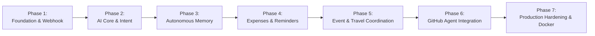

# AURA Master Implementation Plan & Roadmap

## 1. Phased Delivery Roadmap

---

## 2. Detailed Phase Breakdown

### Phase 1: Foundation & Webhook Gateway (Current Milestone)
- **Goal:** Establish production-grade FastAPI service, database models, security verification, idempotent webhook ingestion, and end-to-end tests.
- **Deliverables:**
  - FastAPI application with Lifespan management.
  - SQLAlchemy Async database layer with multi-tenant base mixins.
  - Initial 12+ database entities.
  - LINE webhook signature validation (`verify_line_signature`).
  - Webhook event deduplication via `webhookEventId`.
  - Background async event ingestion worker.
  - Health check endpoint (`/api/health`).
  - Automated test suite (Pytest with in-memory / test SQLite & Async Client).
- **Exit Criteria:** All automated tests pass with 100% green status; zero untracked exceptions.

### Phase 2: AI Core & Conversational Intelligence
- **Goal:** Bilingual conversational engine capable of understanding natural Thai and English with contextual intent routing.
- **Deliverables:**
  - Pluggable LLM interface (`BaseLLMClient`, `GeminiLLMClient`, `OpenAICompatibleClient`).
  - Three-tier autonomy dispatcher: L1 (Observe), L2 (Assist), L3 (Execute).
  - Context window manager assembling recent group dialogue and active members.
  - Quiet group chat etiquette logic (silence vs. proactive response triggers).

### Phase 3: Autonomous Group Memory
- **Goal:** Group-scoped episodic and factual memory repository.
- **Deliverables:**
  - Memory extraction tools (`save_group_memory`, `search_group_memories`).
  - Memory lifecycle management (`correct_group_memory`, `delete_group_memory`).
  - TTL expiration and source tracking by original message ID.
  - Injection of active group facts into conversational context.

### Phase 4: Expense Manager & Scheduled Reminders
- **Goal:** Core productivity tools for day-to-day group collaboration.
- **Deliverables:**
  - Expense split calculator (equal shares, itemized items, payer tracking).
  - Outstanding balances and debt settlement ledger.
  - APScheduler integration for one-time and recurring group reminders.
  - Thai natural language datetime extraction.
  - Task management (creation, assignment, deadline tracking, status transitions).

### Phase 5: Event & Travel Planning
- **Goal:** Facilitate group trips, meetups, and consensus coordination.
- **Deliverables:**
  - Travel proposal detection.
  - Availability polling and participant RSVP tracking.
  - Itinerary generator with budget estimation.
  - Human-in-the-loop approval gates for external bookings.

### Phase 6: GitHub Developer Agent
- **Goal:** Automate software workflows from chat for developer groups.
- **Deliverables:**
  - GitHub API connector with token security.
  - Repository status and commit/PR summarizer.
  - Draft issue creator and branch helper.
  - Strict security policy: public repository publication requires multi-member approval; destructive deletion requires explicit confirmation.

### Phase 7: Production Hardening & Operations
- **Goal:** Deployable, observable, and resilient production setup.
- **Deliverables:**
  - Containerization with multi-stage `Dockerfile` and `docker-compose.yml` (PostgreSQL 16).
  - Migration management with Alembic.
  - Structured JSON logging and Prometheus/OpenTelemetry metrics.
  - Load testing and error recovery verification.

